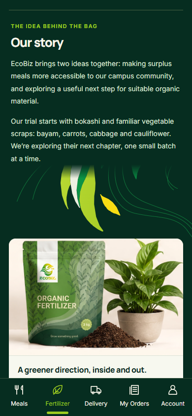
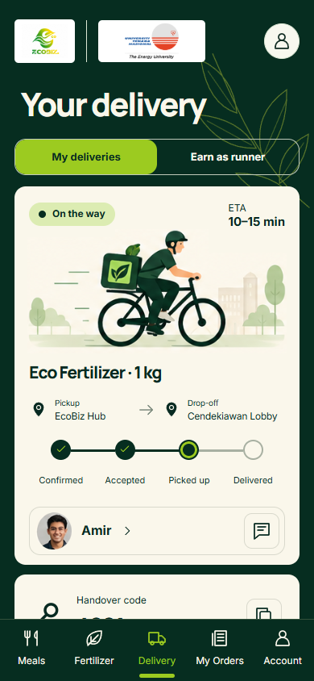

# EcoBiz

**Tonight’s good food. Reserve now. Pay at pickup.**

EcoBiz is a student-led food-rescue project focused on the UNITEN campus in Malaysia. The app brings together campus meal reservations, an experimental fertilizer story and sample orders, and student delivery. This repository also includes the business model, product plan, project schedule and pitch deck.

**Current status:** a local demo with sample meals, accounts, orders and deliveries saved in your browser. Authentication, a shared database, real payments and delivery services are not connected. Use invented profile details only.

[What you can try](#what-you-can-try) · [Try the app](#try-the-app-on-windows) · [App screenshots](#app-screenshots) · [Project documents](#project-documents)

## What you can try

| As a customer | As sample staff |
| --- | --- |
| Browse sample meals and check pickup details. | Create and publish sample meal offers. |
| Reserve a meal and reopen its pickup pass. | Find a reservation and confirm handover and payment received. |
| Cancel before the cutoff and review reservation history. | Review daily sample totals and download a sample CSV. |

You can also read the **Fertilizer** story, compare 1/3/5 kg packs and create a sample order. In **Delivery**, explore the customer tracker or switch to **Earn as runner** to try a sample delivery job.

Meal reservations simulate **reserve now, pay at pickup**. A pickup pass is a reservation, not proof of payment or collection. No action in this demo charges money or books a real delivery.

## Try the app on Windows

No coding, Node.js installation or terminal commands are needed.

1. [Download EcoBiz as a ZIP](https://github.com/nerolynx27/EcoBiz/archive/refs/heads/main.zip).
2. Right-click the ZIP, choose **Extract All**, then open the extracted EcoBiz folder.
3. Double-click **[START_ECOBIZ.bat](START_ECOBIZ.bat)**. Wait for your browser to open.

The launcher prepares everything for you. It uses Node.js 24 if available, otherwise downloads a private copy from the official Node.js website and verifies its SHA-256 checksum. It installs dependencies, prepares the latest app and opens it in your browser. Source, image and dependency changes are detected automatically, so you never need to rebuild manually. The first start can take a few minutes and needs an internet connection. Later starts reuse the setup and prepared app unless files change.

Keep the launcher window open while testing. Close it when you finish. To return, double-click the same file again. This supports **64-bit Windows 10/11 (x64 or ARM64)** and does not require administrator access or change your system Node.js installation.

The browser opens a local address, normally **http://127.0.0.1:3001**. If that port is busy, the launcher chooses another between 3002 and 3010. Use the address it opens; browser records are separate for each address and browser.

If startup fails, the window stays open with an explanation. Check your connection, make sure the whole ZIP has been extracted, and try again. Keep the launcher beside the **ecobiz-app** folder.

### A quick tour

- **Meals:** open a meal, select **Reserve**, continue with the demo account and enter invented details. Confirm the sample reservation, then find its pickup pass through **My Orders → Meal reservations**.
- **Fertilizer:** read **Our story**, scroll to **Choose your pack**, select a size and confirm a sample order. Open **My Orders** to see it.
- **Delivery:** view the sample tracker, then select **Earn as runner**, turn on availability and accept a sample job. Mark it picked up and use the sample handover code **4821** to complete it.

The delivery tracker is an illustrative sample, rather than live tracking of the order you just created. Staff controls and detailed recovery scenarios are covered in the [application guide](ecobiz-app/README.md#full-demonstration). To start the meal demo again, open **Demo controls → Reset demo** on Meals; this resets the meal demo, not fertilizer orders or runner jobs. The meal clock is fixed at **1 October 2026, 9:15 pm Malaysia time**, independent of today’s date.

## App screenshots

<table>
  <tr>
    <th>Meals</th>
    <th>Fertilizer · Our story</th>
    <th>Delivery</th>
  </tr>
  <tr>
    <td></td>
    <td></td>
    <td></td>
  </tr>
</table>

Actual app captures at a 390 × 844 mobile viewport. All displayed offers, orders and delivery details are samples.

## Development and checks

Developer setup and automated checks

The app uses Next.js, React, TypeScript and CSS Modules. Developers can use Node.js 24 and npm directly from ecobiz-app:

    npm ci
    npm run dev -- --webpack --port 3001

For automated checks:

    npm run typecheck
    npm run lint
    npm test
    npm run build -- --webpack

On Windows, also run the launcher checks:

    powershell.exe -NoProfile -ExecutionPolicy Bypass -File tests/launcher.ps1

Keep a server running, then run both browser scripts from a second PowerShell window. Match BASE_URL to the address of that server:

    $env:BASE_URL = 'http://127.0.0.1:3001'
    node tests/commerce-browser.mjs
    node tests/browser.mjs

Browser checks use installed Microsoft Edge. The customer/staff script also accepts BROWSER_CHANNEL=chrome. Browser tests cover the sample journeys, storage recovery, keyboard interaction and responsive layouts. Local captures go into ecobiz-app/screenshots/; curated README images live in docs/readme/. See the [verification record](docs/VERIFICATION.md).

For a production preview, stop the development server, build with npm run build -- --webpack, then run npm run start -- --port 3001. The one-click launcher uses a production preview and rebuilds automatically when source files, assets, configuration or dependencies change.

## Project documents

| Document | What it explains |
| --- | --- |
| [Business model canvas](documents/business/ECOBIZ_BUSINESS_MODEL_CANVAS.md) | Intended campus operations, business choices, assumptions and validation needs. |
| [Product and app plan](documents/product/ECOBIZ_APP_PLAN.md) | Original product requirements and proposed backend work; plans are not claims of implemented features. |
| [Project schedule](documents/schedule/ECOBIZ_PROJECT_GANTT_CHART.xlsx) | Editable planning workbook. |
| [Pitch deck PDF](<deliverables/pitch-deck/EcoBiz Pitch deck.pdf>) | Project presentation; read alongside the current demo status above. |
| [Backend handoff](ecobiz-app/BACKEND_HANDOFF.md) | Frontend contracts, backend guarantees still needed and live-release requirements. |

The fertilizer page describes experimental bokashi development and offers sample pack selection. Its formulation, plant suitability and application guidance still need validation; the project does not claim verified effectiveness, waste-reduction or commercial results.

## Repository map

    START_ECOBIZ.bat  One-click Windows setup and demo launcher
    ecobiz-app/       Application source, runtime assets, tests and detailed guide
    documents/       Selected business/product documents and editable schedule
    deliverables/    Selected pitch-deck PDF
    assets/brand/    Original EcoBiz logo
    docs/            README visuals, licensing notices and verification record
    LICENSE          MIT license for the original project code

The private .ecobiz setup cache, installed dependencies, generated builds and local test captures are excluded from Git. Recordings, recovery ZIPs, historical audits and bulk design inputs also stay outside version control.

## Current boundaries

Demo sessions and roles are local controls, not authentication. State is editable, unencrypted browser data. Uploaded-photo previews are temporary and do not become persistent uploads. Support details and operating policies still need approval. Production use requires backend transactions, server-side authorization, real authentication, approved vendor arrangements and the release checks in the backend handoff.

For changes, keep the sample workflows and their tests aligned, use the existing package scripts and update the relevant guide. The app’s [AGENTS.md](ecobiz-app/AGENTS.md) contains its framework-specific contributor instructions.

## License and credits

The original project code is available under the [MIT License](LICENSE). EcoBiz was developed with AI assistance. Inter and Manrope retain their supplied SIL Open Font License notices. Logos and other visual materials have separate rights considerations; MIT does not grant rights to third-party trademarks. See [asset and third-party notices](docs/THIRD_PARTY_NOTICES.md). The UNITEN logo identifies the campus context and does not imply institutional endorsement.
