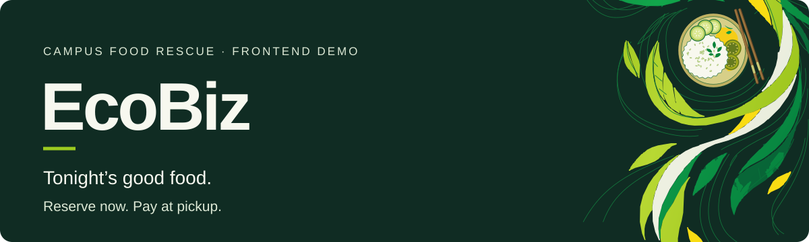
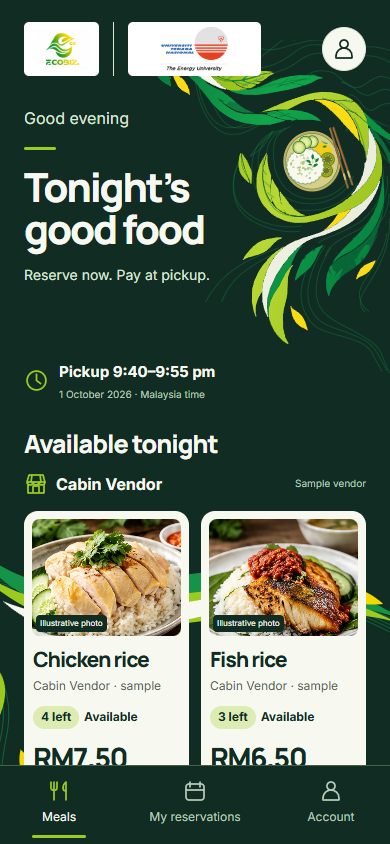
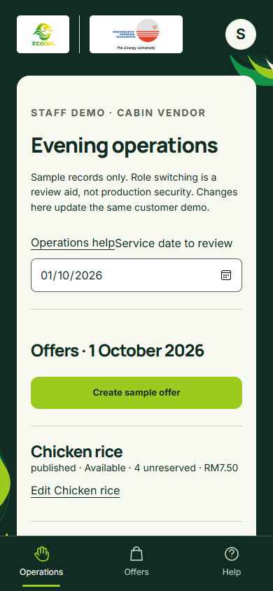

# EcoBiz

**Tonight’s good food. Reserve now. Pay at pickup.**

EcoBiz is a student-led food-rescue project focused on the UNITEN campus in Malaysia. This repository brings together a meal-reservation frontend demo, the business model, the product plan, the project schedule, and the pitch deck.

**Current status:** a local demo with sample meals, sample accounts, and browser storage. Authentication, a shared database, real payments, and deployment are not connected. Use invented profile details only.

[Run locally](#run-locally) · [Try the demo](#try-the-demo) · [Project documents](#project-documents) · [Backend handoff](ecobiz-app/BACKEND_HANDOFF.md)

## What you can try

| As a customer | As sample staff |
| --- | --- |
| Browse sample meals and check pickup details. | Create and publish sample meal offers. |
| Reserve a meal and reopen its pickup pass. | Find a reservation and confirm handover and payment received. |
| Cancel before the cutoff and review reservation history. | Review daily sample totals and download a sample CSV. |

These workflows simulate **reserve now, pay at pickup**. A pickup pass is a reservation, not proof of payment or collection. Staff payment confirmation records a demo event; it does not process a payment.

<p>
  
  
</p>

## Run locally

Use **Node.js 24 and npm**. From the repository root:

```sh
cd ecobiz-app
npm ci
npm run dev -- --port 3001
```

Open [http://127.0.0.1:3001](http://127.0.0.1:3001). Keep the terminal open; press Ctrl+C to stop the server.

For a production build, stop the development server, then run:

```sh
npm run build
npm run start -- --port 3001
```

On Windows, [run_me.bat](ecobiz-app/run_me.bat) provides a double-click launcher. It installs dependencies and builds when the expected files are absent. After changing source, run `npm run build` yourself before using the launcher again. Optional same-network access and firewall instructions are in the [application guide](ecobiz-app/README.md#access-over-the-same-wi-fi--lan).

## Try the demo

1. Open **Demo controls → Reset demo**. The sample clock returns to **1 October 2026, 9:15 pm Malaysia time**; it does not follow today's date.
2. Choose **Staff demo · Cabin Vendor**. Create a sample offer and confirm publication.
3. Switch to **Guest**, browse a meal, select **Reserve**, and continue with the demo account. Enter invented profile details and confirm the sample reservation.
4. Reopen the pickup pass from **My reservations**. The meal is reserved for payment at pickup.
5. Switch back to staff, find the reservation reference, check **Meal handed over** and **Payment received**, then confirm completion.
6. Review the customer's completed reservation and the staff sample totals. Reset before starting a separate scenario.

Browser records belong to that browser and origin. Changing device, hostname, or port gives separate storage. Review in one tab; the demo does not provide reliable shared inventory or secure staff authorization. The [application guide](ecobiz-app/README.md) covers cancellation, recovery scenarios, photo previews, and the detailed demonstration.

## Development and checks

The app uses Next.js, React, TypeScript, and CSS Modules. Run these commands from `ecobiz-app/`:

```sh
npm run typecheck
npm run lint
npm test
npm run build
```

For browser checks, keep the app running on port 3001 and use a second terminal:

```sh
npm run test:browser
```

The browser script uses installed **Microsoft Edge** by default and runs both customer and staff journeys, including 320, 390, and 1440 pixel viewport checks. To use installed Chrome instead, set `BROWSER_CHANNEL=chrome`; set `BASE_URL` to test another local address. In PowerShell:

```powershell
$env:BROWSER_CHANNEL = 'chrome'
$env:BASE_URL = 'http://127.0.0.1:3001'
npm run test:browser
```

Browser tests write local captures into `ecobiz-app/screenshots/`, which is excluded from Git. Curated README captures live separately under `docs/readme/`. The [verification record](docs/VERIFICATION.md) states what was checked and its limits.

## Project documents

| Document | What it explains |
| --- | --- |
| [Business model canvas](documents/business/ECOBIZ_BUSINESS_MODEL_CANVAS.md) | Intended campus operations, business choices, assumptions, and validation needs. |
| [Product and app plan](documents/product/ECOBIZ_APP_PLAN.md) | Original product requirements and proposed backend work; plans are not claims of implemented features. |
| [Project schedule](documents/schedule/ECOBIZ_PROJECT_GANTT_CHART.xlsx) | Editable planning workbook. |
| [Pitch deck PDF](<deliverables/pitch-deck/EcoBiz Pitch deck.pdf>) | Project presentation; read alongside the current demo status above. |
| [Backend handoff](ecobiz-app/BACKEND_HANDOFF.md) | Frontend contracts, backend guarantees still needed, and live-release requirements. |

EcoBiz's wider business direction includes investigating recovery of suitable organic waste. Fertilizer production and sales are not implemented application features, and the project does not claim verified waste-reduction or commercial results.

## Repository map

```text
ecobiz-app/       Application source, runtime assets, tests, and setup guide
documents/       Selected business/product documents and editable schedule
deliverables/    Selected pitch-deck PDF
assets/brand/    Original EcoBiz logo
docs/            README visuals, licensing notices, and verification record
LICENSE          MIT license for the original project code
```

Recordings, recovery ZIPs, historical audits, bulk design inputs, installed dependencies, and generated application builds stay outside version control. A local working folder can contain more than the published repository; excluding an item does not delete it.

## Current boundaries

Demo sessions and roles are local controls, not authentication. State is editable, unencrypted browser data. Uploaded-photo previews are temporary and do not become persistent uploads. Support details and operating policies still need approval. Production use requires backend transactions, server-side authorization, real authentication, approved vendor arrangements, and the release checks described in the backend handoff.

For changes, keep the sample workflows and their tests aligned, use the existing package scripts, and update the relevant guide. The app's [AGENTS.md](ecobiz-app/AGENTS.md) contains its framework-specific contributor instructions.

## License and credits

The original project code is available under the [MIT License](LICENSE). EcoBiz was developed with AI assistance. Inter and Manrope retain their supplied SIL Open Font License notices. Logos and other visual materials have separate rights considerations; MIT does not grant rights to third-party trademarks. See [asset and third-party notices](docs/THIRD_PARTY_NOTICES.md). The UNITEN logo identifies the campus context and does not imply institutional endorsement.
